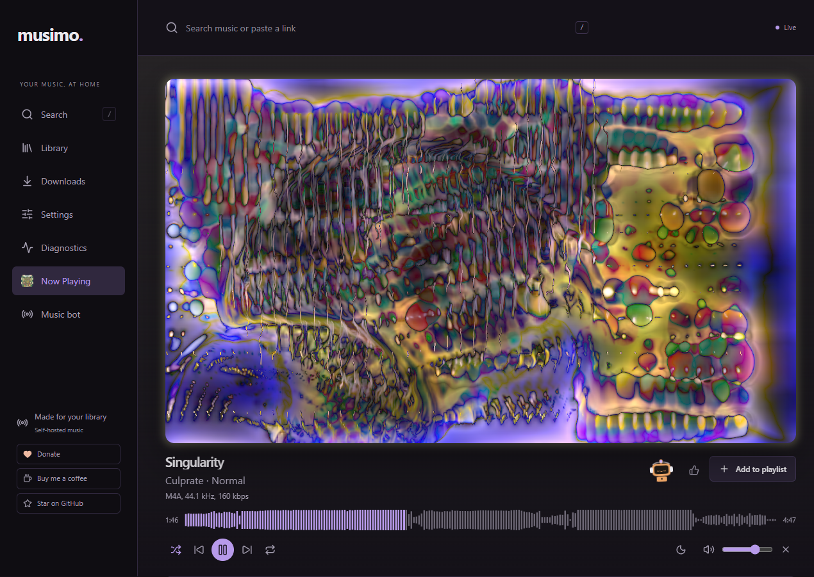
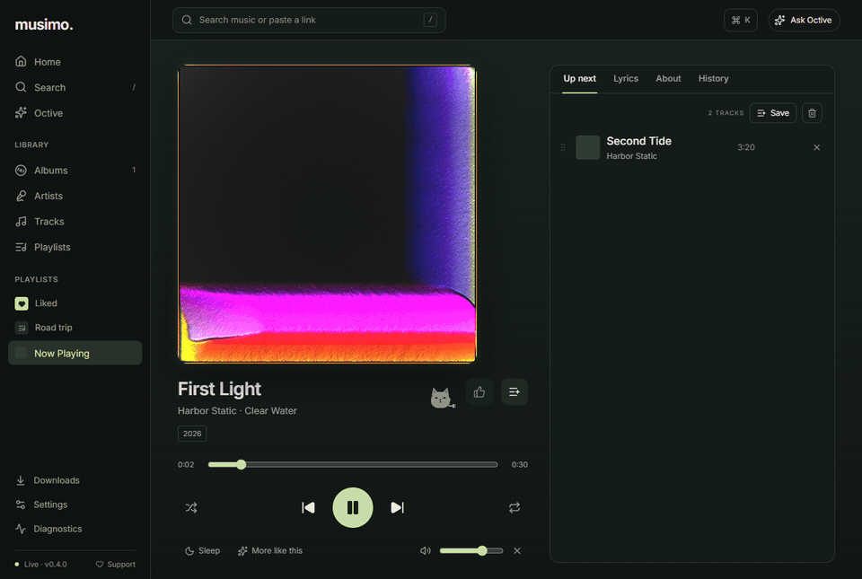
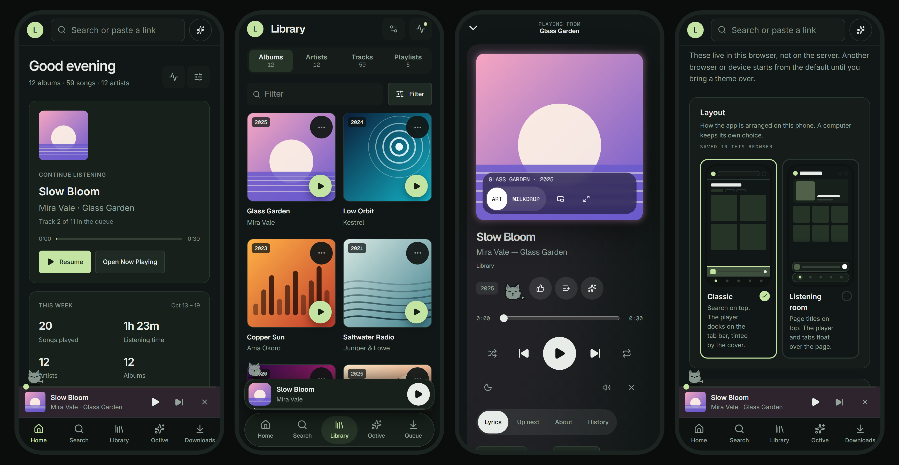
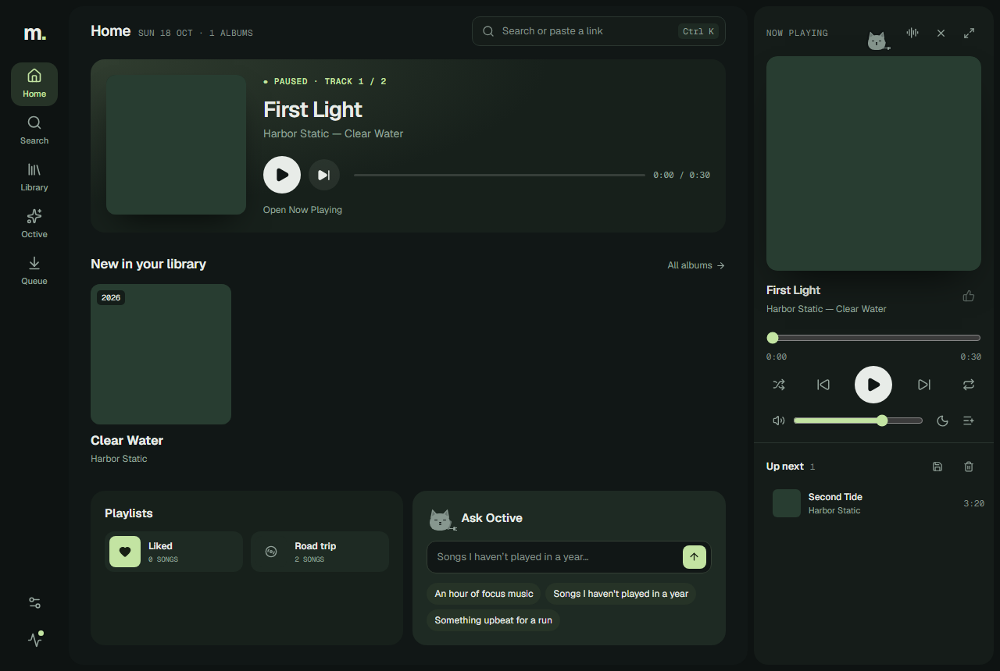
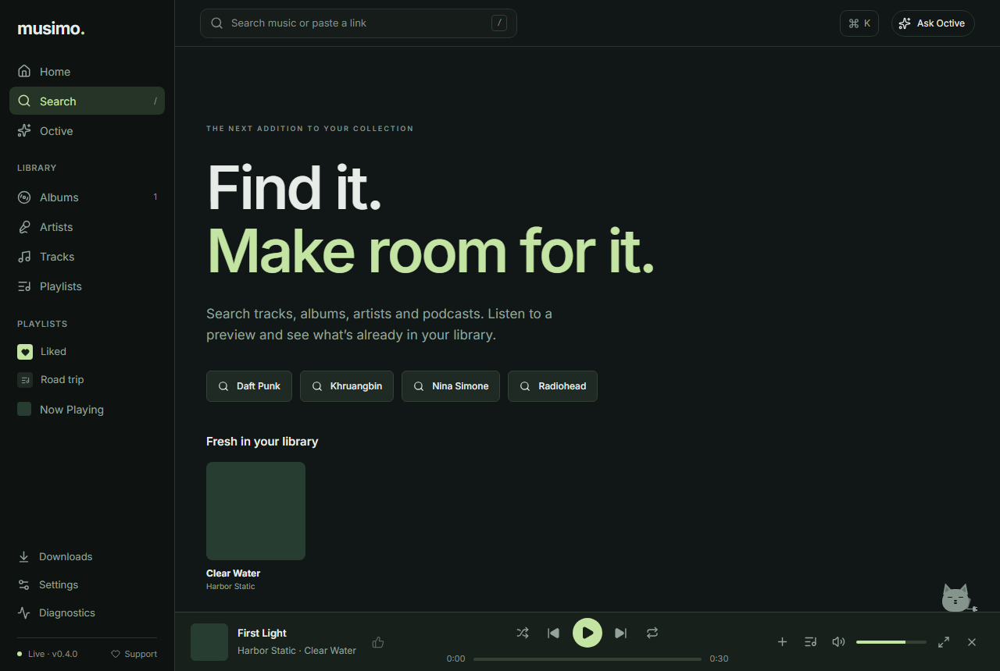
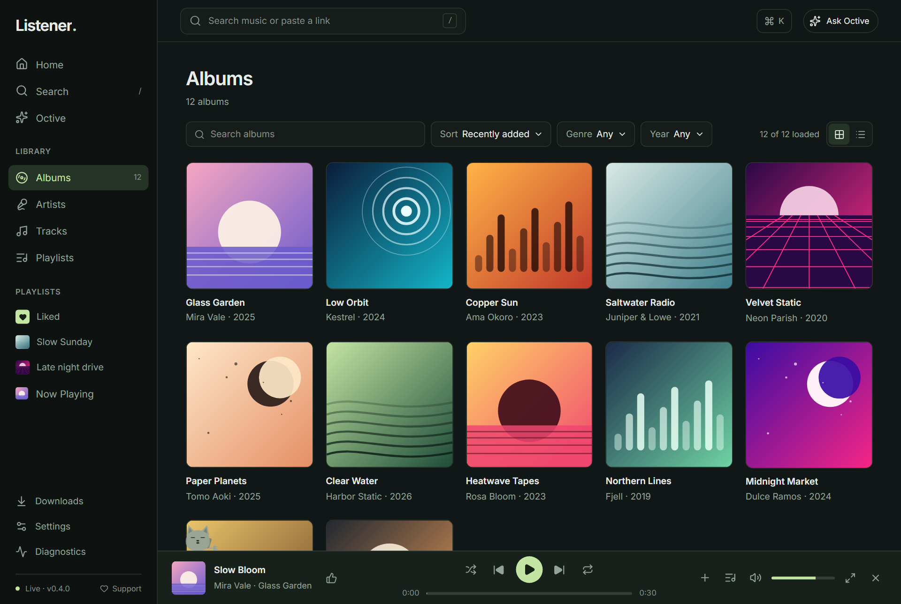
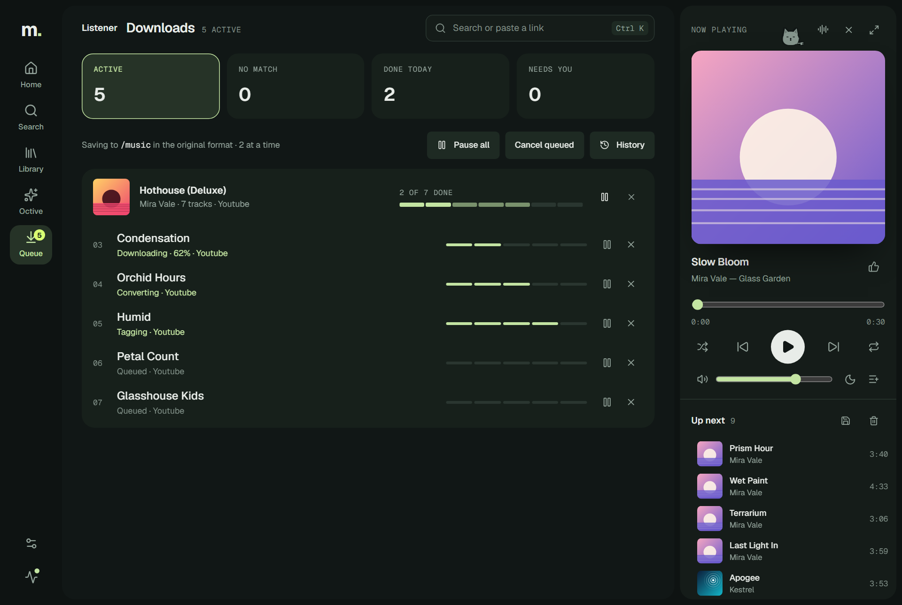
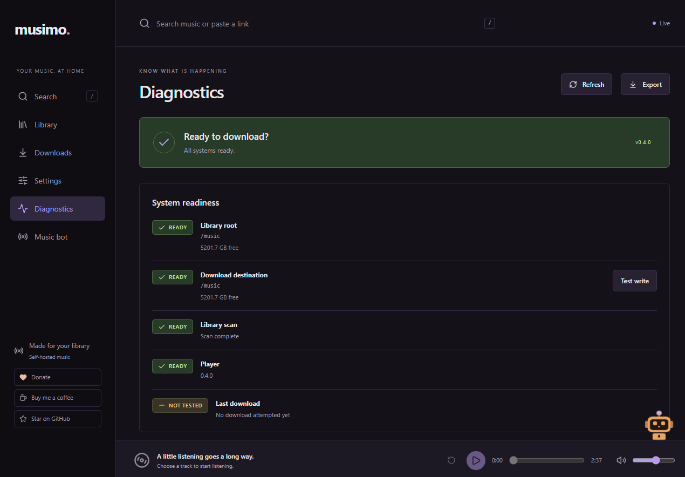

<div align="center">

# musimo

### Your music, at home.

A music app for the collection you own. It runs on your own computer and plays in any browser, on your desktop or your phone.

[Get started](docs/install.md) · [See what it does](#what-it-does) · [Documentation](docs/README.md)

</div>



## Why Musimo

Streaming apps rent you music. Your own files deserve better than a folder of filenames. Musimo turns them into a library you'll want to open: big artwork, a player that moves from one song to the next without a gap, and a way to find what's missing from your shelves.

- **It's yours.** It runs on your hardware, with no Musimo account and no analytics. Your library and your listening stay at home.
- **It's beautiful.** Covers fill the screen, the page takes on the album's colours, and a MilkDrop visualizer dances to the song.
- **It knows your shelves.** Search the catalog and every result tells you whether you already own it.
- **It's made for your phone too.** It isn't the desktop squeezed down. Each layout has its own phone design.

## What it does

### Plays your whole collection, beautifully

Gapless playback, optional crossfade, lyrics that follow along, a sleep timer, playlists and likes. Now Playing goes full screen or pops out into its own window, and the seek bar draws the song's waveform.



<p align="center"><sub>Press V and the artwork becomes a visualizer that moves with the music.</sub></p>

### Fits in your hand

Two layouts, each with its own phone design. Classic docks the player on the tab bar, tinted by the cover. The Listening room floats it. Add Musimo to your home screen and it opens like an app.



### Pick the room you listen in

Classic gives you a sidebar with your library and playlists. The Listening room keeps the player and Up next docked beside whatever you're browsing. Switch any time in Settings.



### Find it, and know if you have it

Search tracks, albums, artists and podcasts. Every result is checked against your library, so you see what you own, what you own in another edition, and what's missing. Hear a preview before you decide.

<table>
<tr>
<td width="50%" valign="top">

</td>
<td width="50%" valign="top">

</td>
</tr>
<tr>
<td align="center"><b>Search</b>, checked against your library.</td>
<td align="center"><b>Library</b>, by artist, album, track and playlist.</td>
</tr>
</table>

### Fill the gaps you're allowed to fill

For music you have the right to keep, Musimo can download the missing songs into your library, tag them and put them in the right folder. You can watch every song go through match, download, convert, tag and move. If one fails, it says why in plain words and links to the fix.

<table>
<tr>
<td width="50%" valign="top">

</td>
<td width="50%" valign="top">

</td>
</tr>
<tr>
<td align="center"><b>Downloads</b>, every step in view.</td>
<td align="center"><b>Diagnostics</b>, so you know it's ready.</td>
</tr>
</table>

### Ask for a mix

Octive, a small pet that sits on the player, builds a queue from your own library: "an hour of 90s rock", "songs I haven't played lately", "more like this". It uses a model you run yourself with [Ollama](https://ollama.com), so your requests stay on your own machines. You see the list before anything plays.

### And more

Paste a link from YouTube, Bandcamp, SoundCloud, the Internet Archive and others to save it. Find podcasts and save episodes. Bring over your playlists, likes and play counts from Navidrome. Choose from twelve themes, or make your own.

<p align="center"><sub>Every artist, album and cover in these pictures is invented.</sub></p>

## Get started

You need [Docker](https://docs.docker.com/get-docker/). Then:

```sh
git clone https://github.com/LeahyCC/musimo.git
cd musimo
docker compose up -d --build --wait
```

Open [http://127.0.0.1:8765](http://127.0.0.1:8765). The first build takes a few minutes.

Next, [point it at your music](docs/install.md#music-folders-and-permissions). Or let an assistant do the whole setup with you: give it the [setup handoff prompt](docs/setup-handoff.md).

## Good to know

- **It's early.** Version 0.4.0 is the first release. It's tested, but expect rough edges. The [changelog](CHANGELOG.md#known-limitations) lists what's known.
- **Keep it on your own network.** There's no built-in login. To reach it from outside, put it behind a [proxy with a login](docs/reverse-proxy.md) or a private network such as Tailscale.
- **Download only what you have the right to keep.** Owning a copy or paying for a subscription doesn't on its own give you that right. See [Terms and responsible use](TERMS.md).

## Learn more

|                                            |                                                                     |
| ------------------------------------------ | ------------------------------------------------------------------- |
| [Install and run](docs/install.md)         | Requirements, music folders, settings, backups, updates and privacy |
| [Using Musimo](docs/guide.md)              | Every feature in detail, and what isn't finished yet                |
| [Troubleshooting](docs/troubleshooting.md) | When something doesn't work                                         |
| [Developing Musimo](docs/development.md)   | Local setup, checks, architecture and the API                       |
| [All documentation](docs/README.md)        | Everything else, from plans to test evidence                        |

## Support the project

If Musimo is useful to you, [star it on GitHub](https://github.com/LeahyCC/musimo). If you want to support the people who make the music, [donate to MusiCares](https://www.musicares.org/).

Bug reports, accessibility fixes and small improvements are welcome. Read [Contributing](CONTRIBUTING.md) first, and report security issues privately as [Security](SECURITY.md) explains.

Musimo's code is under the [MIT licence](LICENSE). That licence gives no rights to recordings, artwork, lyrics or provider accounts. Musimo isn't connected to or endorsed by any of the services it works with. See [Privacy](PRIVACY.md) and [third-party notices](THIRD_PARTY_NOTICES.md).
